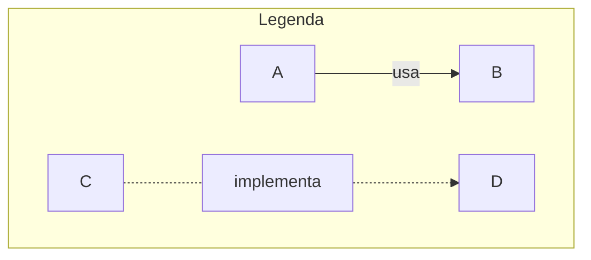
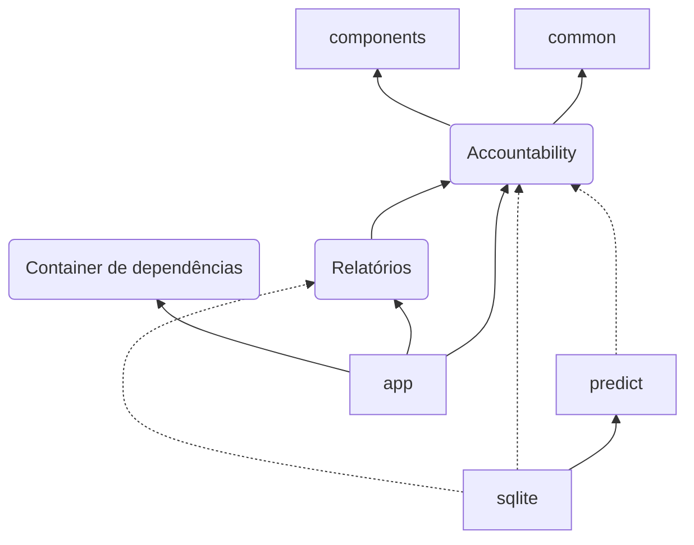

# Arquitetura

Organização do projeto

- app: aplicação
- docs: documentação
- predict: serviço de predição

# App

A aplicação principal do Biluca Finanças. Desenvolvido em [Flutter](https://github.com/BrunoBiluca/biluca-knowledge/tree/main/Frontend/Flutter).





Módulos

accountability
common
components
predict
reports
sqlite
app
cd

# Backup no Google Drive

A aplicação oferece backup opcional do banco SQLite no Google Drive, disponível apenas nas plataformas Windows e Linux.

- Interface e regras: `lib/core/backup/` (modelos, `BackupService`, detecção de conflito e `BackupBloc`).
- Integração com o Google: `lib/integrations/google_drive/` (OAuth pelo navegador, Drive API e persistência local dos metadados).
- Apresentação: página de configurações em `lib/app/settings/`, estado da sincronização na página inicial em `lib/app/home/` e modal de fechamento em `lib/app/app_exit/`.
- Sincronização: na abertura da aplicação e no fechamento, com escolha entre manter o arquivo local ou atualizar com o do Google Drive quando ambos foram alterados.
- Pasta utilizada no Google Drive: `biluca.com/Biluca Finanças/<perfil>`, com uma subpasta por perfil de sincronização.
- Perfil de sincronização: nome fixo definido em configuração, com valor padrão `principal`, usado para separar o backup de desenvolvimento do backup da aplicação real. A variável de ambiente `BILUCA_BACKUP_PROFILE` sobrescreve o nome; o perfil ativo aparece na página de configurações.
- Autorização: feita pelo navegador com retorno para `http://localhost`; a tentativa é cancelável e expira em 2 minutos, e a sincronização expira em 60 segundos, exibindo o motivo retornado pelo Google.

## Credenciais OAuth

As credenciais do cliente OAuth ficam fora do versionamento, em `secrets/google_oauth.json` (a pasta `secrets/` é ignorada pelo Git). O arquivo deve conter:

```json
{
  "clientId": "<client id do projeto OAuth>",
  "clientSecret": "<client secret do projeto OAuth>"
}
```

O caminho pode ser sobrescrito pela variável de ambiente `BILUCA_GOOGLE_OAUTH_FILE`. O arquivo precisa ser distribuído junto da instalação para que a conexão com o Google Drive funcione.

No projeto OAuth do Google Cloud, o tipo de cliente deve ser de aplicativo instalado (desktop) ou aceitar o redirecionamento `http://localhost` (a porta é escolhida dinamicamente em tempo de execução). Além disso:

- a API do Google Drive precisa estar habilitada;
- o escopo `https://www.googleapis.com/auth/drive.file` precisa constar na tela de consentimento (Google Auth Platform → Data Access). Sem ele, o Google concede apenas `openid` e `userinfo.email`, a conexão é recusada e a página de configurações indica a permissão faltante.

O arquivo de credenciais é procurado, nesta ordem:

1. caminho indicado em `BILUCA_GOOGLE_OAUTH_FILE`;
2. `secrets/google_oauth.json` ao lado do executável (instalação);
3. `secrets/google_oauth.json` no diretório atual (execução pelo projeto).

O instalador inclui `secrets/google_oauth.json` em `{app}\secrets`; o arquivo precisa existir na máquina de build antes de gerar o pacote.

# Atualização automática

A aplicação verifica a versão publicada no GitHub Releases na abertura e oferece a atualização a partir da página inicial ou das configurações. Disponível apenas no Windows, única plataforma com instalador Inno Setup.

- Regras e estado: `lib/core/app_update/` (`models/`, interface `AppUpdateService` com a implementação para plataformas sem instalador, e `AppUpdateBloc`).
- Integrações: `lib/integrations/github_releases/` (consulta do release mais recente e seleção do instalador anexado), `lib/integrations/app_update/` (download do instalador e abertura do wizard do Inno Setup).
- Apresentação: notificação em `lib/app/home/widgets/` e seção de atualização em `lib/app/settings/widgets/`.
- Encerramento: o fluxo de saída fica em `lib/app/app_exit/application_exit_handler.dart` e é reutilizado tanto pelo fechamento da janela quanto pela atualização, garantindo a sincronização do backup antes de encerrar.
- Ordem da atualização: download do instalador → confirmação → fluxo de fechamento → processo auxiliar aguardando o término da aplicação → abertura do wizard do Inno Setup.
- Diagnóstico: o processo auxiliar grava o resultado da abertura em `<instalador>.launch.log`, ao lado do instalador baixado na pasta temporária (`biluca-financas-update`), já que ele sobrevive ao processo da aplicação.
- Contrato de publicação consumido pela aplicação (endpoint e nome do instalador): ver [Publicação](./Publicação.md).
